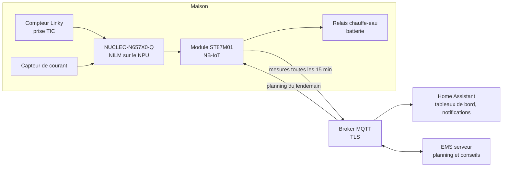
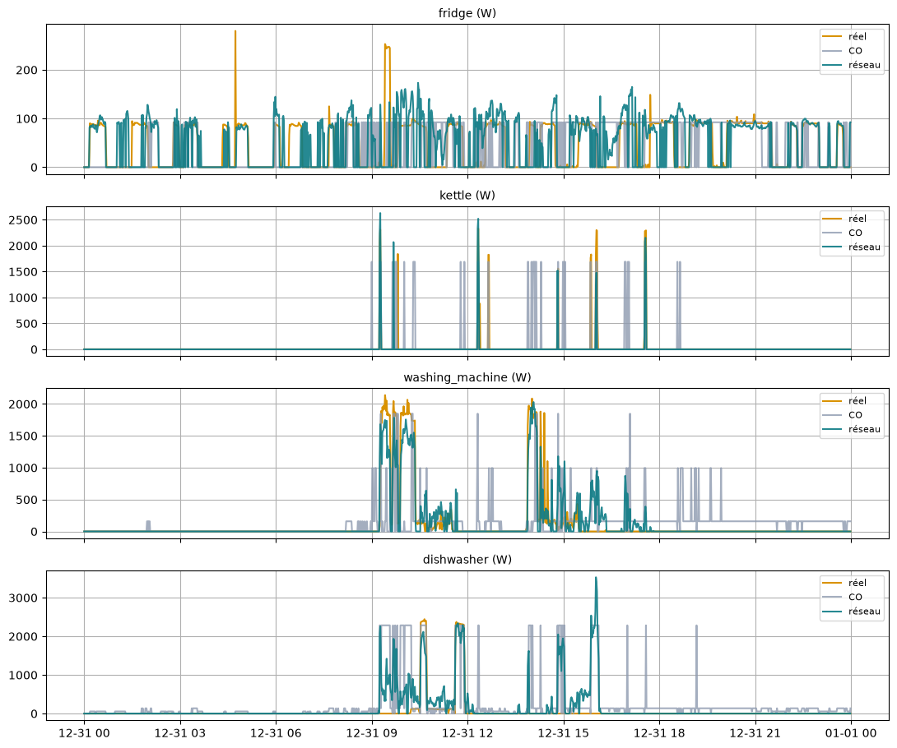
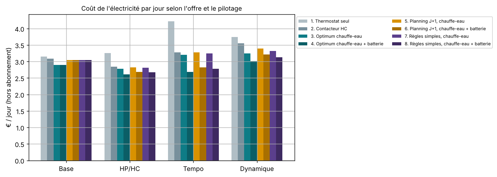

# NILM connecté en NB-IoT pour l'optimisation énergétique sous Home Assistant

[](https://github.com/bastianglld/nilm-nbiot-home-assistant/actions/workflows/tests.yml)

Projet M1 ESET, Université Savoie Mont Blanc (2026-2027), sujet proposé par STMicroelectronics.

Un boîtier placé au tableau électrique mesure la consommation totale du logement. Il reconnaît les appareils en marche à partir de cette seule mesure (NILM, *Non-Intrusive Load Monitoring*), envoie le résultat en NB-IoT vers un serveur, et Home Assistant l'affiche. Le serveur renvoie chaque jour un planning qui décale les usages flexibles (chauffe-eau, batterie, lave-linge, lave-vaisselle) vers les heures où l'électricité coûte le moins cher.

## Architecture



L'IA est répartie en deux niveaux :

- **sur la carte** (*edge AI*) : un réseau de neurones de 22 120 paramètres reconnaît le frigo, la bouilloire, le lave-linge et le lave-vaisselle dans la courbe totale. Il tourne sur l'accélérateur Neural-ART du STM32N6 en 2 ms ;
- **sur le serveur** : l'EMS (*Energy Management System*) apprend les habitudes du foyer, prépare le planning du lendemain selon le prix (Tempo, heures creuses, prix spot) et rédige des conseils chiffrés.

## Avancement

| Brique | Responsable | État |
|---|---|---|
| Modèle NILM entraîné sur données publiques (UK-DALE) | Bastian | Fait : F1 de 0,75 à 0,91 selon l'appareil |
| Export int8 et validation sur la NUCLEO-N657X0-Q | Bastian | Fait : 2,05 ms par inférence, 99,5 % de décisions identiques au PC |
| EMS serveur : prix réels, planning, profils d'usage, conseils | Bastian | Fait en simulation sur un an de données |
| Format des messages montants et descendants | Bastian, avec A et B | Proposé : [docs/protocole_messages.md](docs/protocole_messages.md) |
| Interface TIC Linky vers STM32 | Merveille, Bastian | Schéma proposé : [docs/interface_tic.md](docs/interface_tic.md) |
| Module NB-IoT ST87M01 et capteur | Merveille | À intégrer dans [`firmware/`](firmware/) |
| Broker MQTT TLS et Home Assistant | Mathieu | À intégrer dans [`cloud/`](cloud/) et [`homeassistant/`](homeassistant/) |

## Résultats principaux

**Reconnaissance des appareils** (maison 1 de UK-DALE, période de test jamais vue à l'entraînement) :

| Appareil | F1 réseau | F1 référence (CO) | Erreur d'énergie du réseau |
|---|---|---|---|
| Frigo | 0,81 | 0,50 | 16 % |
| Bouilloire | 0,75 | 0,30 | 26 % |
| Lave-linge | 0,91 | 0,23 | 2 % |
| Lave-vaisselle | 0,87 | 0,06 | 15 % |

La version int8 qui tourne sur la carte garde les mêmes scores (écart de F1 inférieur à 0,02).



**Pilotage selon le prix** (hiver 2024-2025 rejoué avec les vrais prix, chauffe-eau de 5 kWh/jour et batterie de 5 kWh simulés) :

| Offre | Contacteur heures creuses classique | Planning EMS | Économie |
|---|---|---|---|
| HP/HC | 2,84 €/jour | 2,67 €/jour | 6 % |
| Tempo | 3,31 €/jour | 2,80 €/jour | 15 % |
| Prix spot (dynamique) | 3,56 €/jour | 3,14 €/jour | 12 % |

Sur un an, l'analyse des habitudes conseille l'offre Tempo à ce foyer (environ 1 066 €/an contre 1 180 €/an en Base).



## Organisation du dépôt

| Dossier | Contenu |
|---|---|
| [`nilm/`](nilm/) | Notebooks des semaines 1 à 10, modèle entraîné, export ONNX int8 et validation sur la carte |
| [`flexibilite/`](flexibilite/) | `ems_serveur.py`, le programme qui tourne sur le serveur, et des exemples de messages |
| [`firmware/`](firmware/) | Code de la carte et tests du ST87M01 |
| [`cloud/`](cloud/) | Configuration du broker MQTT (TLS, droits d'accès) |
| [`homeassistant/`](homeassistant/) | Configuration MQTT et tableaux de bord |
| [`docs/`](docs/) | Format des messages, interface TIC, décisions techniques ([`docs/adr/`](docs/adr/)), figures |
| [`data/`](data/) | Où placer les données UK-DALE (non versionnées) |
| [`tests/`](tests/) | Tests automatiques de l'EMS serveur |

## Démarrage rapide

```bash
pip install -r requirements.txt

# tests de l'EMS (sans connexion internet)
python -m unittest discover tests

# planning d'un jour rouge de l'hiver 2024-2025 (les prix sont fournis dans le dépôt)
cd nilm/notebooks
python ../../flexibilite/ems_serveur.py planning --historique profils_s9/messages_15min_nilm.csv --offre Tempo --jour 2025-01-21

# notebooks
jupyter notebook
```

Les notebooks qui entraînent le réseau (semaines 3 à 7) demandent PyTorch et les données UK-DALE, voir [`data/README.md`](data/README.md).

## Équipe

- **Bastian Guilloud** (C) : modèle NILM, IA embarquée et EMS serveur (flexibilité, prix, profils d'usage)
- **Mathieu Hegoburu** (A) : serveur, Home Assistant et sécurité (broker MQTT, TLS)
- **Merveille-Joresse Ngoulou-Wamena** (B) : module NB-IoT ST87M01 et capteur

Client : Éric Djakam (STMicroelectronics).

## Licence

- Code : [MIT](LICENSE) © 2026 Bastian Guilloud, Mathieu Hegoburu, Merveille-Joresse Ngoulou-Wamena
- Documents et figures (`docs/`) : [CC BY 4.0](https://creativecommons.org/licenses/by/4.0/deed.fr)
- Données UK-DALE : non incluses, sous licence CC BY 4.0. Source : J. Kelly et W. Knottenbelt, « The UK-DALE dataset », *Scientific Data* 2:150007, 2015
- Couleurs Tempo et prix spot : données publiques RTE / EDF (api-couleur-tempo.fr) et Energy-Charts (Fraunhofer ISE)
