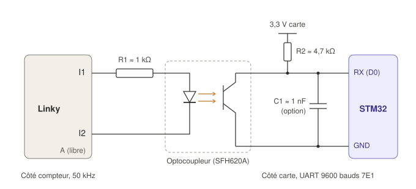

# Interface TIC Linky vers STM32

Proposition de montage pour lire la téléinformation client (TIC) du compteur Linky avec la NUCLEO-N657X0-Q. Aucun module TIC du commerce ne communique en NB-IoT (les produits existants passent par Zigbee, Wi-Fi, LoRaWAN ou Modbus) : l'interface est donc à réaliser par l'équipe. Fabrication : Merveille (B). Décodage des trames : Bastian (C).

## Fonctionnement

- **Signal du Linky.** Entre les bornes I1 et I2, le compteur envoie une porteuse à 50 kHz : porteuse présente = bit 0, absente = bit 1. La borne A (alimentation d'un module) n'est pas utilisée, la carte ayant sa propre alimentation.
- **R1 (environ 1 kΩ).** Limite le courant dans la LED de l'optocoupleur.
- **Optocoupleur à entrée alternative** (SFH620A ou LTV-814). Il suit la porteuse dans les deux sens et isole électriquement le compteur de la carte. La masse du Linky ne doit jamais être reliée à celle de la NUCLEO.
- **R2 (environ 4,7 kΩ) vers le 3,3 V.** Au repos, le transistor est bloqué et RX est à 1 ; avec la porteuse, il conduit et RX passe à 0. Le signal arrive dans le bon sens, sans inverseur.
- **C1 (environ 1 nF, optionnel).** Lisse le reste de la porteuse. À ajuster à l'oscilloscope : trop gros, il arrondit les bits à 9 600 bauds.

## Réglage de l'UART

| Mode TIC | Débit | Format |
|---|---|---|
| Standard (par défaut sur les Linky récents) | 9 600 bauds | 7 bits, parité paire, 1 bit de stop |
| Historique | 1 200 bauds | 7 bits, parité paire, 1 bit de stop |

Avec la HAL STM32, le format 7E1 se règle en mot de 8 bits avec parité paire (`UART_WORDLENGTH_8B`, `UART_PARITY_EVEN`) ; on masque ensuite le bit de poids fort de chaque octet reçu.

## Ce que la carte lit

En mode standard, une trame arrive toutes les une à deux secondes, avec notamment : `SINSTS` (puissance apparente instantanée, VA), `EAST` (index total, Wh), `LTARF` (tarif en cours), `STGE` (registre d'état, qui contient la couleur Tempo du jour et du lendemain). Le NILM utilise la puissance instantanée moyennée sur la minute, comme le canal `aggregate` de UK-DALE.

## À valider

- Valeurs de R1, R2 et C1 avec la spécification Enedis-NOI-CPT_54E et un relevé à l'oscilloscope sur un vrai Linky.
- Broche RX à utiliser sur la NUCLEO-N657X0-Q (D0 sur le connecteur Arduino), à vérifier dans le manuel de la carte car elle peut être partagée avec le ST-LINK.
- Résolution de la mesure : la TIC donne une puissance par seconde au mieux. Le capteur de courant reste prévu pour une mesure plus fine, comme le demande le sujet.
