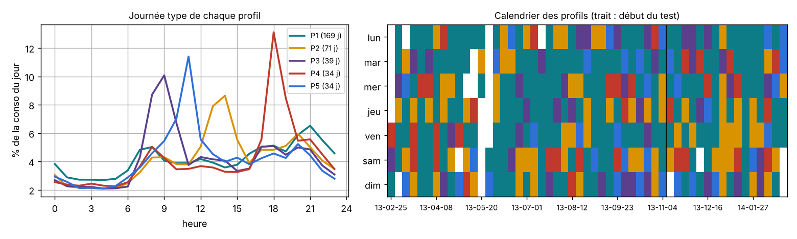

# EMS côté serveur : planning selon le prix et profils d'usage

Partie C du projet (Bastian Guilloud). [`ems_serveur.py`](ems_serveur.py) est le programme qui tourne sur le serveur, à côté du broker MQTT et de Home Assistant. Il reprend dans un seul module les études des [semaines 8, 9 et 10](../nilm/README.md#les-notebooks-semaine-par-semaine).

## Ce qu'il fait

| Tâche | Quand | Entrée | Sortie |
|---|---|---|---|
| Enregistrer les mesures | en continu | messages de la carte sur `nilm/maison/etat` | historique CSV des quarts d'heure |
| Planning du lendemain | chaque jour vers 13 h 30, après la publication des prix | historique, offre du foyer, prix du lendemain | message de 32 caractères sur `nilm/maison/cmd/plan` et notification du soir |
| Analyse et conseils | chaque semaine | historique d'au moins quelques semaines | recommandations JSON sur `nilm/maison/conseils` |

Le planning décide, heure par heure, quand le chauffe-eau peut chauffer, quand la batterie charge ou se décharge, et à quelle heure lancer le lave-linge et le lave-vaisselle. Les règles sont simples et vérifiables : le chauffe-eau chauffe aux heures les moins chères, juste assez pour ne jamais manquer d'eau chaude ; la batterie se charge aux 2 heures les moins chères et ne se décharge que si l'écart de prix couvre ses pertes.

L'analyse apprend les habitudes du foyer à partir des données du NILM : heure habituelle des machines, profils de journées (regroupement automatique), consommation de veille. Elle compare le coût annuel des offres Base, HP/HC et Tempo et classe les conseils par gain en euros.

Exemples de sorties : [plan Tempo](exemples/plan_demain_Tempo.json), [plan prix spot](exemples/plan_demain_Dynamique.json), [conseils](exemples/conseils.json). Les formats sont décrits dans [`../docs/protocole_messages.md`](../docs/protocole_messages.md).

## Sources de prix

| Offre | Source |
|---|---|
| Base, HP/HC | tarifs EDF TTC au 1er août 2026 (6 kVA), heures creuses de 22 h à 6 h |
| Tempo | tarifs EDF et couleur du jour sur api-couleur-tempo.fr (publiée vers 11 h pour le lendemain) |
| Dynamique | prix spot France sur Energy-Charts (publié vers 13 h), plus 0,085 €/kWh hors énergie et TVA (hypothèse) |

Les prix téléchargés sont gardés dans le dossier `prix/` du dossier de travail. Les tarifs se changent dans la classe `Config`.

## Utilisation

**Sur le serveur : voir [`deploiement/`](deploiement/)** (installation en une commande, services et tâches automatiques).

À la main, par exemple depuis un PC :

```bash
pip install numpy pandas paho-mqtt
export MQTT_PASSWORD='...'                 # mot de passe du compte ems, jamais sur la ligne de commande

# en continu : enregistrer les messages de la carte
python ems_serveur.py enregistreur --historique historique.csv --broker <adresse> --utilisateur ems [--tls]

# chaque jour à 13 h 30 : planning de demain, publié avec retain pour que la carte le récupère à son réveil
python ems_serveur.py planning --historique historique.csv --offre Tempo --publier --broker <adresse> --utilisateur ems [--tls]

# chaque lundi : analyse et conseils (7 jours d'historique au moins)
python ems_serveur.py analyse --historique historique.csv --offre-actuelle Base --publier --broker <adresse> --utilisateur ems [--tls]
```

Connexion : `--port` (1883 par défaut, 8883 avec `--tls`), `--cafile` pour l'autorité de test du broker Docker. Sans `--publier`, rien n'est envoyé ; sans `paho-mqtt`, le programme affiche la commande `mosquitto_pub` équivalente.

## Résultats en simulation

Hiver 2024-2025 rejoué jour par jour avec les vrais prix, la consommation de la maison 1 de UK-DALE estimée par le NILM, un chauffe-eau de 5 kWh/jour et une batterie de 5 kWh :

| Offre | Contacteur heures creuses | EMS | Économie | Heures sans eau chaude |
|---|---|---|---|---|
| HP/HC | 2,84 €/jour | 2,67 €/jour | 6 % | 0 |
| Tempo | 3,31 €/jour | 2,80 €/jour | 15 % | 0 |
| Prix spot | 3,56 €/jour | 3,14 €/jour | 12 % | 0 |

Les règles simples atteignent 74 à 84 % de l'économie maximale calculée par optimisation linéaire en connaissant tous les prix à l'avance (semaine 8).



## Ce qui reste à faire

- Installer l'EMS sur le VPS avec Mathieu ([`deploiement/`](deploiement/)) et vérifier le téléchargement des prix depuis le serveur.
- Valider avec Merveil le décodage du message de planning sur la carte et la commande du relais.
- Estimer l'état de la cuve à minuit avec une vraie mesure (fixé à 60 % pour l'instant).
- Ajouter les radiateurs et le chauffe-eau au NILM, ou les mesurer directement, pour des conseils plus complets.

Tests : `python -m unittest discover tests` depuis la racine du dépôt.
