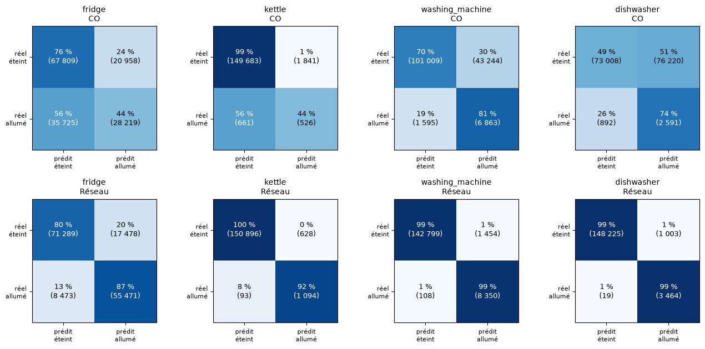

# NILM : reconnaître les appareils à partir d'une seule mesure

Partie C du projet (Bastian Guilloud). Ce dossier contient tout le travail sur l'IA : l'étude des données, le modèle de reconnaissance des appareils, son export vers la carte STM32N6, puis l'IA côté serveur (prix, planning, profils d'usage).

## Le modèle en bref

| | |
|---|---|
| Appareils reconnus | frigo, bouilloire, lave-linge, lave-vaisselle |
| Entrée | 3 × 272 valeurs : les 272 dernières minutes de puissance totale (kW, moyenne par minute), sinus et cosinus de l'heure |
| Sortie | 8 × 272 valeurs : puissance de chaque appareil (W) et score allumé / éteint, minute par minute |
| Réseau | convolutif 1D dilaté, 7 blocs résiduels (dilatations 1 à 64 min), 32 canaux, 22 120 paramètres |
| Données d'entraînement | UK-DALE, maison 1, ramenée à la minute (voir [`../data/README.md`](../data/README.md)) |
| Sur la carte | int8, 2,05 ms par inférence sur le NPU de la NUCLEO-N657X0-Q, une inférence toutes les 15 minutes |
| Message envoyé | `hhmm;frigo;bouilloire;lave_linge;lave_vaisselle;total` en Wh par quart d'heure ([format](../docs/protocole_messages.md)) |

Les échelles, la fenêtre et les seuils utilisés par la carte sont dans [`notebooks/export_s7/nilm_meta.json`](notebooks/export_s7/nilm_meta.json).

## Les notebooks, semaine par semaine

Chaque notebook commence par son objectif et se termine par une conclusion (entrées, sorties, résultats, limites).

| Semaine | Notebook | Ce qu'il apporte |
|---|---|---|
| 1 | [Exploration de UK-DALE](notebooks/semaine01_exploration_ukdale.ipynb) | Choix de la maison, des 4 appareils et du pas d'une minute |
| 2 | [Référence sans apprentissage](notebooks/semaine02_baseline_co.ipynb) | Optimisation combinatoire (CO) et modèle naïf : F1 de 0,11 à 0,48, le plancher à battre |
| 3 | [Réseau de neurones](notebooks/semaine03_reseau_neurones.ipynb) | Réseau convolutif dilaté comparé au CO sur le même test ; une variante plus grosse n'apporte rien |
| 4 | [Confusion et flexibilité](notebooks/semaine04_confusion_flexibilite.ipynb) | Matrices de confusion, choix du seuil, première simulation chauffe-eau et batterie |
| 5 | [Données simulées](notebooks/semaine05_donnees_simulees_lpg.ipynb) | Ajout de foyers simulés (LoadProfileGenerator) à l'entraînement |
| 6 | [Choix du modèle final](notebooks/semaine06_entrainement_final.ipynb) | 12 entraînements (données, augmentation, 3 graines) : UK-DALE seul, sans augmentation, retenu |
| 7 | [Export vers la STM32N6](notebooks/semaine07_export_stm32.ipynb) | Fenêtre glissante, ONNX, compression int8, vecteurs de test pour la carte |
| 8 | [Prix réels et planning](notebooks/semaine08_prix_planning.ipynb) | Tarifs EDF, jours Tempo et prix spot réels, planning du lendemain, message de 32 caractères |
| 9 | [Profils d'usage](notebooks/semaine09_profils_usage.ipynb) | IA côté serveur demandée par le client : habitudes, profils de journées, offre conseillée, alertes |
| 10 | [EMS serveur](notebooks/semaine10_ems_serveur.ipynb) | Fusion des semaines 8 et 9 dans [`../flexibilite/ems_serveur.py`](../flexibilite/ems_serveur.py) |

Les semaines 1 à 4 ont été exécutées sous Google Colab : leurs sorties ne sont pas enregistrées, les chiffres sont repris dans les conclusions. Les semaines 5 à 10 contiennent leurs sorties et leurs figures.

## Résultats

Test sur une période de UK-DALE que le réseau n'a jamais vue ([`runs_s6/ukdale_augoff_s0/resultats_nilm.csv`](notebooks/runs_s6/ukdale_augoff_s0/resultats_nilm.csv)) :

| Appareil | F1 réseau | F1 int8 (carte) | F1 CO | Erreur d'énergie du réseau |
|---|---|---|---|---|
| Frigo | 0,81 | 0,80 | 0,50 | 16 % |
| Bouilloire | 0,75 | 0,76 | 0,30 | 26 % |
| Lave-linge | 0,91 | 0,92 | 0,23 | 2 % |
| Lave-vaisselle | 0,87 | 0,88 | 0,06 | 15 % |

## Validation sur la carte

Le modèle int8 a été compilé avec ST Edge AI Core 2.2 et exécuté sur la NUCLEO-N657X0-Q avec 20 fenêtres réelles ([journal complet](stm32/resultat_validation_carte.txt), [script](stm32/etape3_validation.sh)) :

| Mesure | Résultat |
|---|---|
| Temps d'une inférence | 2,05 ms (le besoin est d'une inférence toutes les 15 minutes) |
| Opérations sur le NPU Neural-ART | 38 étapes sur 54 (les convolutions), le reste sur le Cortex-M55 |
| Mémoire | 76 Ko de poids, 59 Ko d'activations |
| Accord carte / PC | cosinus 0,9997, 99,5 % de décisions allumé / éteint identiques |

## Lancer les notebooks

Le dossier `notebooks/` est le dossier de travail : chaque notebook lit les sorties des semaines précédentes à côté de lui. Le dépôt garde celles qui servent à la suite :

| Dossier | Contenu | Produit par |
|---|---|---|
| `runs_s6/ukdale_augoff_s0/` | poids du réseau retenu (`nilm_cnn.pt`) et ses scores | semaine 6 |
| `export_s7/` | modèle ONNX float et int8, `nilm_meta.json` | semaine 7 |
| `prix/` | couleurs Tempo 2023-2025 et prix spot de l'hiver 2024-2025 | semaine 8 |
| `profils_s9/messages_15min_nilm.csv` | un an de messages de 15 minutes estimés par le NILM | semaine 9 |

Les autres sorties (figures, tableaux) sont recréées à chaque exécution et ne sont pas versionnées.

Le chemin des données UK-DALE se règle dans la variable `DATA_DIR` de la première cellule de code. Les semaines 3 à 7 demandent PyTorch, la semaine 7 aussi `onnx` et `onnxruntime`.
